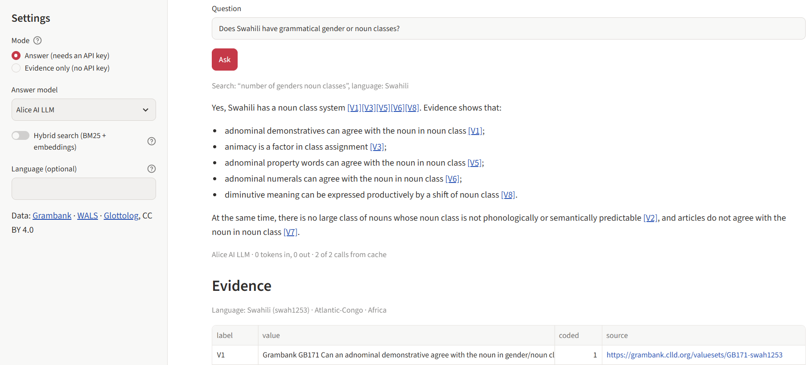

**[English Version / На английском](README.md)**

# GlottoLens

[](https://www.python.org/)
[](https://github.com/IlyaShaposhnikov/glotto-lens/actions)
[](LICENSE)
[](#данные-и-лицензии)
[](https://yandex.cloud/ru/services/ai-studio)

**Онлайн-демо: [glotto-lens.streamlit.app](https://glotto-lens.streamlit.app/)** (для ответов нужен свой ключ Yandex AI Studio; вкладка с доказательствами работает без него)

Задайте вопрос о грамматике языка на английском, русском или другом языке и получите
короткий ответ, в котором каждое утверждение ссылается на запись в типологической базе
данных:

```text
$ glotto-lens ask "Правда ли, что в ирландском глагол стоит в начале предложения?"
Search: 'verb-initial order of subject object and verb VSO', language: 'Irish'

Да, в ирландском языке глагол стоит в начале предложения. Согласно данным WALS, для него
характерен порядок слов VSO (глагол — подлежащее — дополнение) [V3][T9]. Кроме того, по
данным Grambank, для переходных предложений в ирландском немаркированным является именно
глагольно-начальный порядок [V5].

Sources:
[V3] WALS 81A Order of Subject, Object and Verb: Verb-subject-object (VSO) (entry: Irish)
     https://wals.info/datapoint/81A/wals_code_iri
[T9] Order of Subject, Object and Verb / 1. Six types with dominant order (by Matthew S. Dryer)
     https://wals.info/chapter/81
[V5] Grambank GB131 Is a pragmatically unmarked constituent order verb-initial for transitive
     clauses?: present (entry: Irish) https://grambank.clld.org/valuesets/GB131-iris1253
```

(Строки источников перенесены, чтобы поместиться на странице.)

GlottoLens — это генерация, дополненная поиском (RAG), по трем открытым лингвистическим базам:

- [Grambank](https://grambank.clld.org): 195 грамматических признаков примерно для 2 400 языков;
- [WALS Online](https://wals.info): 192 признака и главы, написанные типологами;
- [Glottolog](https://glottolog.org): каталог языков, диалектов и семей, который связывает
  две первые базы через глоттокоды.

Модель никогда не отвечает из собственных знаний. Она получает записанные значения и
подходящие фрагменты текста, ссылается на них по меткам и прямо говорит, если в базах нет
данных. Метки, которые модель выдумала, обнаруживаются и помечаются.

## Как это работает

```text
вопрос ─► переписывание (LLM) ─► название языка + английский запрос в терминах WALS/Grambank
                                  │
            ┌─────────────────────┴──────────────────────┐
            ▼                                            ▼
   поиск языка (названия Glottolog,            полнотекстовый поиск (SQLite FTS5, BM25)
   коды ISO и WALS, диалекты)                  по карточкам признаков и главам WALS
            │                                            │
            └──────────────► доказательства ◄────────────┘
                 записанные значения [V1..] + фрагменты [T1..], у каждого своя ссылка
                                  │
                                  ▼
                ответ (LLM) ─► проверка ссылок ─► ответ с источниками
```

- **Данные.** Закрепленные релизы наборов данных CLDF (Grambank v1.0.3, WALS v2020.6,
  Glottolog v5.4) скачиваются и собираются в одну базу SQLite. Значения, коды, главы WALS,
  описания признаков Grambank и рассчитанные распределения значений становятся документами
  для поиска.
- **Поиск языка.** Названия нормализуются (регистр, диакритика, слова вроде «язык»), а
  совпадения ранжируются: сначала коды, затем языки раньше диалектов и семей, затем вид
  названия. Если у языка нет значения, а у его диалекта есть, показывается значение диалекта
  с пометкой об этом.
- **Поиск признаков.** Один поиск по документам признаков, где от каждого признака берется
  лучший документ, выбирает до 8 признаков; значения языка по ним становятся строками [V].
  С `--hybrid` первые 6 мест остаются за BM25, а последние 2 получают признаки, которые нашли
  эмбеддинги Яндекса (256 измерений, хранятся в том же файле SQLite), а BM25 пропустил.
  Лучшие фрагменты становятся строками [T]. Главы, где упоминается язык, добавляются, только
  если они описывают один из выбранных признаков.
- **Промпты.** Промпт переписывания переводит бытовые формулировки в терминологию баз на
  нескольких примерах («есть ли слово вроде 'the'» → «definite articles»). Промпт ответа
  требует ссылку на каждое утверждение, запрещает выводы сверх доказательств и объясняет,
  что «no value recorded» означает отсутствие данных, а не отсутствие явления в языке. Он также
  называет язык ответа: берет его из самого вопроса, когда это однозначно, а иначе — тот, что
  назвал шаг переписывания.
- **LLM.** [Алиса AI](https://yandex.cloud/ru/services/ai-studio) через совместимый с OpenAI
  Responses API в Yandex AI Studio. Вызовы кешируются на диске, расход токенов записывается
  в журнал, так что повторные прогоны бесплатны.

## Быстрый старт

Python 3.12 или новее.

```bash
git clone https://github.com/IlyaShaposhnikov/glotto-lens.git
cd glotto-lens
python -m venv .venv
source .venv/bin/activate          # Windows: .venv\Scripts\activate
pip install -e ".[dev]"

glotto-lens build                  # скачать три набора данных и собрать data/glottolens.sqlite
```

Для поиска и определения языка API-ключ не нужен:

```bash
glotto-lens lang русский Basque nucl1643       # поиск языка по названию, глоттокоду, коду
glotto-lens search definite articles --per-feature  # признаки в порядке отбора доказательств
glotto-lens evidence "definite articles" -l Basque   # доказательства, которые получит модель
```

Для ответов нужен каталог Yandex Cloud с доступом к AI Studio. Ключ кладется в `.env`
(файл не попадает в git):

```text
YANDEX_API_KEY=...
YANDEX_FOLDER_ID=...
# YANDEX_MODEL=aliceai-llm         необязательно
```

```bash
glotto-lens ask "Сколько падежей в финском языке?"
glotto-lens ask "Is Yoruba a tone language?" --show-context
```

Для гибридного поиска 863 документа признаков векторизуются один раз (несколько минут, около
230 тыс. токенов, с кешем на диске), а затем к каждому вопросу добавляется один вызов:

```bash
glotto-lens embed
glotto-lens ask "Does Swahili have noun classes?" --hybrid
glotto-lens search number of genders noun classes --vectors-only   # только векторный канал
```

Веб-демо, доступное по адресу **[glotto-lens.streamlit.app](https://glotto-lens.streamlit.app/)**,
показывает ответ с кликабельными ссылками и доказательства, на которые он опирается. Для
ответов нужен собственный ключ Yandex AI Studio; вкладка с доказательствами работает без
него. Локальный запуск:

```bash
pip install -e ".[demo]"
streamlit run streamlit_app.py
```

Текст модели показывается как обычный текст: ссылками становятся только метки. Переключатель
гибридного поиска векторизует запрос, поэтому ему нужен ключ и на вкладке доказательств.
Вопросы пишутся в `answers.jsonl`, как у `ask`; если страницей пользуются другие, задайте
`GLOTTO_LENS_LOG=0`. В демо четыре модели, которые работают через Responses API; Qwen,
которому нужен `--api chat`, не включен.



Для публичного развертывания на Streamlit Community Cloud (в настройках приложения Python
3.12; `requirements.txt` фиксирует проверенные версии) хватает трех секретов:

- `GLOTTO_LENS_PUBLIC = "1"`: посетители отвечают своим ключом, никогда не ключом сервера,
  и `answers.jsonl` не пишется;
- `GLOTTO_LENS_DB_URL`: собранная база, сжатая gzip (`gzip -k -9 data/glottolens.sqlite`) и
  прикрепленная к релизу на GitHub;
- `GLOTTO_LENS_DB_SHA256`: хеш самого файла `.gz` (`sha256sum data/glottolens.sqlite.gz`).
  Страница скачивает файл при первом запуске и скачивает заново, когда меняется хеш, так что
  для пересобранной базы нужны только новый файл в релизе и новый хеш.

Даже в публичном режиме на сервере остаются кеш модели (`data/cache/llm`: промпты хранятся
в виде хешей, тексты ответов — целиком) и журнал токенов (`llm_usage.jsonl`: время и число
токенов), поэтому повторный вопрос ничего не стоит. Ключи посетителей нигде не записываются.

Тот же конвейер доступен как компоненты LangChain (`pip install -e ".[langchain]"`):
`BaseRetriever`, который возвращает доказательства как `Document` с метками и ссылками, и
цепочка LCEL: переписывание → поиск → ответ → проверка ссылок. Цепочка принимает модель
GlottoLens или любую чат-модель LangChain; с той же моделью она отправляет те же промпты, что
`glotto-lens ask`, и это проверяет тест. В отличие от `ask`, она не пишет строку в
`answers.jsonl` и не предупреждает, если модель оборвала ответ.

```python
from glotto_lens.langchain_adapter import GlottoLensRetriever, build_chain
from glotto_lens.llm import CachedModel, YandexModel

docs = GlottoLensRetriever(language="Finnish").invoke("number of cases")
result = build_chain(CachedModel(YandexModel())).invoke({"question": "Сколько падежей в финском?"})
print(result["answer"], result["sources"])
```

`glotto-lens КОМАНДА --help` показывает параметры каждой команды; `python -m glotto_lens.answer`
и другие модули работают так же. Данные, кеш и отчеты хранятся в `data/` (или в каталоге из
`GLOTTO_LENS_DATA`).

## Оценка качества

Набор [`eval/questions.jsonl`](eval/questions.jsonl) содержит 41 вопрос на русском и
английском о 24 языках: на 33 ответ в данных записан, на 8 — нет. Для каждого вопроса указан
признак, который на него отвечает, и глоттокод, в который должно определиться название языка.
Ожидаемые значения не пишутся вручную: они берутся из базы, а команда `check` проверяет, что
каждый вопрос согласуется с данными.

Второй набор, [`eval/heldout.jsonl`](eval/heldout.jsonl), — 32 вопроса (23 со значением, 9 без
данных) о 30 языках, и ни одного из них нет в первом наборе; за этим следит тест. Набор
закоммичен до первого прогона и для настройки не используется (`--questions eval/heldout.jsonl`).

Еще два набора по 25 вопросов проверяют, что ответ приходит на языке вопроса:
[`eval/multilingual.jsonl`](eval/multilingual.jsonl) для настройки и отложенный
[`eval/multilingual-heldout.jsonl`](eval/multilingual-heldout.jsonl). Оба охватывают
английский, русский, испанский, немецкий, французский, португальский, итальянский,
китайский, японский и корейский, и в обоих есть вопросы на языке о нем самом.

```bash
glotto-lens eval check                     # бесплатно: вопросы согласуются с данными
glotto-lens eval gaps grambank:GB020       # бесплатно: языки без значения, для новых вопросов
glotto-lens eval run --retrieval-only      # почти бесплатно: только переписывание и поиск
glotto-lens eval run                       # полный прогон, около 105 тыс. входных токенов
glotto-lens eval run --judge --judge-model deepseek-v4.1-flash   # и вердикт LLM на каждый ответ
glotto-lens eval run -m yandexgpt-5.1 --rewrite-model aliceai-llm  # другая модель на тех же доказательствах
glotto-lens eval run --retrieval-only --hybrid --fusion rrf      # гибридный поиск, другое слияние
```

Каждый отчет записывает, от чего он зависит: git-коммит кода, релизы данных, хеши промптов,
набора вопросов и кода метрики, настройки поиска, а также модели и их настройки (API,
уровень рассуждения). Ответы и вердикты кешируются, поэтому повтор завершенного прогона или
прогона с упавшими вызовами оплачивает только недостающее.

### Метрики

| Метрика | Считается на | Вопрос засчитан, если |
|---|---|---|
| язык определен | всех вопросах | название языка сопоставилось с глоттокодом вопроса |
| признак найден | всех вопросах | нужный признак есть в доказательствах, которые видит модель |
| верный ответ | вопросах со значением | язык определен верно, и ответ ссылается на строку нужного признака с записанным значением |
| честный ответ | вопросах без данных | язык определен верно, признак найден, на записанное значение ответ не ссылается и говорит, что данных нет |
| без неверных ссылок | всех вопросах | ответ ссылается только на метки, которые есть в доказательствах |
| язык ответа | вопросах, где язык вопроса и ответа удается определить | ответ на языке вопроса (`langid.py`: по письменности или по служебным словам для шести языков на латинице) |
| судья (с `--judge`) | всех вопросах | LLM получает вопрос, записанное значение и ответ, но не доказательства, и решает, что ответ называет это значение или признает, что данных нет |

Судья — перекрестная проверка, а не главная метрика: где он расходится с проверками кодом,
ответ читается вручную. Так нашлись еще три формулировки «данных нет» (см. ниже).

### Результаты: поиск

Алиса AI (`aliceai-llm`), температура 0. Каждая строка — одно изменение, измеренное на всем
наборе. Отчеты, на которых построены строки, лежат в [`eval/reports/`](eval/reports): там все
ответы, признаки из доказательств и хеши промптов, вопросов и метрики. У строк 2 и 3 ответы
одни и те же, различается только `metrics_sha256`. Строка 4 измерена на коммите `10c926e`,
строка 5 — на `ff0740a`; начиная со строки 4 отчеты записывают коммит, более ранние строки
относятся к более ранним коммитам.

| Этап | Признак найден | Верный ответ | Честный ответ | Неверные ссылки | Отчет |
|---|---|---|---|---|---|
| Исходный вариант: 3 документа признаков в доказательствах | 33/40 | 26/33 | 4/7 | 0 | [1](eval/reports/1-baseline.json) |
| Признаки выбираются из широкого пула; пример «noun classes» в промпте переписывания | 39/41 | 31/33 | 5/8 | 0 | [2](eval/reports/2-wider-pool.json) |
| Те же ответы, проверка честности распознает больше формулировок (только метрика) | 39/41 | 31/33 | 8/8 | 0 | [3](eval/reports/3-metric-only.json) |
| Пул считает признаки, а не документы; «noun classes → number of genders» | 40/41 | 31/33 | 8/8 | 0 | [4](eval/reports/4-pool-by-feature.json) |
| Гибридный поиск (`--hybrid`): 2 места из 8 для признаков, которые нашли только эмбеддинги | **41/41** | **33/33** | **8/8** | **0** | [5](eval/reports/5-hybrid.json) |

Что видно из таблицы:

- Почти все провалы были провалами поиска. Если нужный признак доходил до модели, она
  ссылалась на верное значение во всех случаях, кроме одного, и ни разу не выдумала ссылку.
- Grambank описывает каждый признак в нескольких разделах, и каждый раздел — отдельный
  документ. Пул из нескольких документов часто вмещал один-два признака, поэтому WALS 30A
  «Number of Genders» вытесняли десяток признаков Grambank об именных классах. Ранжирование
  признаков вместо документов исправило большую часть таких случаев.
- Третья строка не меняет ни одного ответа, только метрику: честные ответы вроде «WALS does
  not record the number of cases for Hindi» раньше не распознавались. Честность в исходной
  строке посчитана более ранней версией проверки.
- После исходного прогона в наборе стало 41 вопрос вместо 40 (добавлен английский вопрос без
  данных).
- Последняя строка сначала измерена на коммите `12ac20d`, а после изменения языка ответа —
  еще раз на `ff0740a` (см. «Результаты: язык ответа»): цифры те же, и каждый ответ на языке
  своего вопроса (41/41). Судья согласился со всеми 33 значениями и теперь не принимает
  только `abk-GB028`. `kom-30A` он принял, потому что с новым промптом изменился сам ответ:
  теперь в нем сказано, что в WALS нет значения для числа родов. Отчет на `12ac20d` остался
  в истории git файла `5-hybrid.json`.

### Гибридный поиск

BM25 сравнивает слова, эмбеддинги — смысл. Векторный канал поставил WALS 30A первым для
«number of genders noun classes», где BM25 ставил выше десяток признаков Grambank об именных
классах. Сам по себе он слабее: для «number of vowel phonemes» он поставил показатели числа из
Grambank и признаки WALS о согласных выше WALS 2A, который у BM25 первый. Поэтому вопрос был в
том, как слить два ранжирования. Только поиск, те же переписанные вопросы:

| Слияние | Набор для настройки (41) | Отложенный набор (32) |
|---|---|---|
| Только BM25 | 40/41 | 32/32 |
| Reciprocal rank fusion (RRF, k = 60) | 38/41 | — |
| Зарезервированные места: первые 6 от BM25, затем 2 лучших признака только из векторов | **41/41** | **32/32** |

- RRF поощряет совпадение: признак, который оба канала поставили на 3–5 места, обгоняет первый
  признак любого из каналов. Он дважды потерял WALS 2A и не вернул 30A.
- Зарезервированные места не дают вытеснить выбор BM25 и все же пропускают признак, который
  нашли только векторы. Они вернули `en-swa-30A` и ничего не потеряли; с ответами
  `en-swa-30A` стал верным ответом «пять или больше родов» со ссылкой на WALS 30A.
- Выигрыш — один вопрос из 73, а места подобраны на наборе для настройки; отложенный набор
  здесь использован второй раз, только для поиска, и третий, тоже только для поиска, после
  того как в промпте переписывания появился ключ для языка вопроса: 32/32
  ([отчет](eval/reports/heldout-hybrid-retrieval-rewrite3.json)). По умолчанию остается BM25: гибридному поиску нужны
  `glotto-lens embed` и вызов API на каждый вопрос.
- В этом прогоне прошел и `rus-117A`. Его доказательства изменились только на двух последних
  местах, а с теми же признаками он раньше то проходил, то нет, поэтому в заслугу гибридному поиску он не
  записан.

### Результаты: отложенный набор

Алиса AI, настройки строки 4 по поиску (BM25), судья — DeepSeek V4.1 Flash; коммит `c6f6c82`,
один прогон с ответами. По его ответам ничего не настраивалось; позже набор использован еще
два раза, только для поиска, чтобы проверить гибридный поиск и новый промпт переписывания
(см. «Гибридный поиск»).

| Набор | Признак найден | Верный | Честный | Неверные ссылки | Судья: значение | Судья: нет данных | Отчет |
|---|---|---|---|---|---|---|---|
| Набор для настройки (41 вопрос, строка 4 по поиску) | 40/41 | 31/33 | 8/8 | 0 | — | — | [4](eval/reports/4-pool-by-feature.json) |
| Отложенный набор (32 вопроса) | **32/32** | **23/23** | **6/9** | **0** | 23/23 | 7/9 | [heldout](eval/reports/heldout-aliceai-llm.json) |

Что видно из таблицы:

- **Поиск и ответы со значением переносятся на новые вопросы.** Все признаки найдены, в том
  числе WALS 30A для именных классов в зулу — вопрос того же рода, что проваливается для суахили
  в наборе для настройки: «Сколько именных классов (родов)» переписывается в «number of
  genders». Все ответы со значением ссылаются на нужную строку.
- **Честность переносится хуже**, и три промаха разного рода:
  - `h-ita-13A` принимает отсутствие значения за довод: «В итальянском языке нет тонов. Это
    подтверждается отсутствием значения в базе WALS». Его не засчитывают обе проверки; это
    единственная явная ошибка.
  - `h-com-GB020` отвечает по WALS 37A, где у команчи значение есть («demonstrative word used
    as definite article»). Вопрос не называет базу, так что ответ подкреплен данными; вопрос
    оказался слабее, чем выглядел, когда его писали.
  - `h-bak-81A` пишет «Данные о базовом порядке слов (SOV, SVO и т. д.) в WALS не
    зафиксированы». Судья это принимает, а проверка формулировки — нет: точка в «т. д.»
    обрывает окно предложения.
- Честность 8/8 на наборе для настройки была отчасти подогнана: проверка формулировки росла на
  его ответах. На новых вопросах разумная оценка — 7–8 из 9, а проверка кодом сама по себе дает 6.
- Ни один промах здесь не исправлен: если поменять метрику или вопрос после прогона, эта строка
  станет строкой настройки.

### Результаты: язык ответа

Вопрос на испанском о русском получил ответ на русском: промпт говорил «отвечай на языке
вопроса», и модель поняла это как язык, о котором вопрос. Исправление в два шага, каждый
проверен на наборах выше с гибридным поиском и судьей:

1. Шаг переписывания называет язык, на котором написан вопрос, а промпт ответа говорит
   «The question is written in Spanish: write the answer in Spanish». На наборе для
   настройки это дало 21 из 25. По отчетам видно, почему четыре не прошли: модель
   переписывания приняла португальские и итальянские вопросы за испанские, а китайский
   вопрос о японском — за японский, и ответы пошли за ней.
2. Теперь код сам определяет язык вопроса, когда сомнений нет (китайский, японский,
   корейский, греческий, иврит и тайский — по письменности; английский, испанский, немецкий,
   французский, португальский и итальянский — минимум по двум служебным словам), а иначе
   полагается на модель переписывания, например для кириллицы.

| Набор | Коммит | Найдено | Верно | Ответ на языке вопроса | Судья | Отчет |
|---|---|---|---|---|---|---|
| Многоязычный, для настройки (25) | `ff0740a` | 25/25 | 25/25 | **25/25** (21/25 до шага 2) | 25/25 | [multilingual](eval/reports/multilingual.json) |
| Многоязычный, отложенный (25) | `ff0740a` | 25/25 | 25/25 | **25/25** | 25/25 | [multilingual-heldout](eval/reports/multilingual-heldout.json) |

Отложенный набор закоммичен вместе с шагом 2, до первого прогона, и прогнан один раз. Его
ловушки тоже прошли: «Em português, o adjetivo vem antes ou depois do substantivo?» получил
ответ на португальском, «한국어의 기본 어순은 무엇입니까?» — на корейском.

### Результаты: модели-ответчики

Пять моделей из каталога Yandex AI Studio отвечают на те же 41 вопрос по тем же
доказательствам поиска BM25 (строка 4 по поиску): все вопросы переписывает Алиса AI (`--rewrite-model aliceai-llm`), так что
различается только ответ. Температура 0, у DeepSeek и Qwen рассуждение выключено
(`--reasoning-effort none`), судья — DeepSeek V4.1 Flash. Коммит `e5a211b`.

| Модель ответа | Верный | Честный | Ответы с неверными ссылками | Судья: значение | Судья: нет данных | Выходных токенов | Отчет |
|---|---|---|---|---|---|---|---|
| Alice AI LLM (`aliceai-llm`) | 31/33 | 8/8 | 0 | 31/33 | 7/8 | ~2,2 тыс.¹ | [alice](eval/reports/cmp-aliceai-llm.json) |
| Alice AI LLM Flash (`aliceai-llm-flash`) | 31/33 | 8/8 | 0 | 32/33 | 8/8 | 2,2 тыс. | [flash](eval/reports/cmp-aliceai-llm-flash.json) |
| YandexGPT 5.1 Pro (`yandexgpt-5.1`) | **32/33** | 7/8 | 0 | 32/33 | 7/8 | 2,3 тыс. | [yandexgpt](eval/reports/cmp-yandexgpt-5.1.json) |
| DeepSeek V4.1 Flash (`deepseek-v4.1-flash`) | **32/33** | **8/8** | 0 | 32/33 | 8/8 | 7,9 тыс. | [deepseek](eval/reports/cmp-deepseek-v4.1-flash.json) |
| Qwen3.6-35B (`qwen3.6-35b-a3b`) | 31/33 | 8/8 | 1 | 32/33 | 7/7² | 6,4 тыс. | [qwen](eval/reports/cmp-qwen3.6-35b-a3b.json) |
| DeepSeek V4.1 Flash, с рассуждением³ | **32/33** | **8/8** | 0 | 32/33 | 8/8 | 19,7 тыс. | [reasoning](eval/reports/cmp-deepseek-v4.1-flash-reasoning.json) |

¹ Ответы Алисы взяты из кеша, поэтому в отчете нет числа токенов; цифра из последнего
платного прогона и включает шаг переписывания, который в остальных строках взят из кеша. ² Ответ судьи на `kom-30A` обрезан на 2000 токенах.
³ Рассуждение по умолчанию, коммит `892fe3a`; два ответа (`eng-49A`, `yor-13A`) обрезаны на
лимите 1000 токенов, но уже после того, как сослались на значение.

Что видно из таблицы:

- **Модели отличаются не больше чем на один ответ.** На 33 вопросах один ответ — 3 пункта, и
  каждая модель прогонялась один раз, так что таблица их не ранжирует. 32/33 — потолок:
  `en-swa-30A` у всех проваливается на поиске.
- **Ошибки — в ссылках, а не в знаниях.** Алиса AI и Алиса AI Flash на `rus-117A` ссылаются на
  строки Grambank вместо WALS 117A. Qwen на `bsq-37A` пишет «(V1)» без квадратных скобок, а на
  `geo-1A` ссылается на метку, которой нет в доказательствах. YandexGPT на `kom-30A` пишет,
  что рода в коми нет, хотя значения в WALS нет; это единственный ответ, который проверка формулировки считает нечестным.
- **DeepSeek и Qwen пишут втрое длиннее** при тех же оценках, даже без рассуждения.
- **Рассуждение здесь не помогает.** С рассуждением по умолчанию DeepSeek получает ровно те же
  вердикты по всем 41 вопросу, и от проверок, и от судьи, а выходных токенов тратит в 2,5 раза
  больше. Эти вопросы спрашивают значение, которое уже есть в доказательствах: работа в том,
  чтобы найти и процитировать нужную строку, а не что-то вывести. На вопросах, где нужно
  совместить несколько фактов, результат может быть другим.
- **Судья нашел три пробела в проверке честности**: «WALS does not provide a value»,
  «значение не установлено» и отрицание через 16 слов после «значения». Теперь проверка их
  принимает; ни у одного другого ответа ни в одном отчете оценка не изменилась.
- **Судья строже к уклончивым ответам.** На `kom-30A` Алиса пишет, что в WALS значения нет, но
  по данным Grambank делает вывод, что рода нет; проверка формулировки это засчитывает, судья
  нет. На `fra-87A` он не принимает «после существительного, а также в обоих порядках».

## Итоги

**Что работает.** Каждое утверждение в ответе ссылается на запись в WALS или Grambank, и
то, что запись существует, проверяет код, а не модель. С гибридным поиском все 41 вопрос
набора для настройки находят свой признак, все 33 ответа со значением ссылаются на
записанное значение, и все 8 ответов без данных так и говорят. На новых вопросах картина
сохраняется там, где это важно: в отложенном наборе найдено 32/32 признака и верно 23/23
значения, а на отложенных вопросах на десяти языках 25/25 ответов пришли на языке вопроса.

**Что решило дело.** Поиск, а не модель: почти каждая ранняя ошибка была признаком, который
не дошел до модели, и ранжирование признаков вместо документов исправило большинство из
них. Пять моделей-ответчиков различаются не больше чем на один ответ, а рассуждение не
изменило ни одного вердикта. Гибридный поиск добавил один вопрос из 73. Самым крупным
исправлением после этого стал не промпт, а проверка: определение языка вопроса кодом там,
где модель переписывания ошибалась.

**Почему цифрам можно верить.** Ожидаемые значения берутся из базы, а не пишутся вручную;
отложенные наборы закоммичены до первого прогона; каждый отчет записывает коммит, версии
данных и хеши промптов, вопросов и кода метрик; LLM-судья перепроверяет метрики кода, а
каждое расхождение прочитано вручную. Слабые места перечислены ниже, а не подогнаны:
честность на отложенном наборе по проверке фраз — 6/9.

**Что дальше**, примерно по убыванию пользы:

- **Сравнения и общие вопросы** («русский и польский», «в каких языках есть тоны»): два
  языка в вопросе и распределения значений, которые уже проиндексированы.
- **Расширенная оценка с повторами**, чтобы различия моделей шли с интервалами, а не по
  одному прогону.
- **Версия модели эмбеддингов в ключах векторов**, чтобы обновление модели `latest` у
  Яндекса само вызывало пересчет, а не оставалось пунктом в ограничениях.
- **Определение языка за пределами двенадцати языков** — настоящей моделью вместо служебных
  слов, и проверка честности, не зависящая от русских и английских фраз.

## Ограничения

- **Настройка на тестовом наборе, проверка на отложенном.** Параметры поиска, примеры в
  промпте и проверка честности подбирались с оглядкой на 41 вопрос набора для настройки.
  Отложенный набор (32 вопроса о других языках) прогнан один раз с ответами и дважды только
  для поиска, чтобы проверить гибридный поиск и новый промпт переписывания; он маленький, а
  еще один прогон с ответами сделает его уже не отложенным.
- **Маленький набор.** На 33 вопросах со значением один ответ — это 3 процентных пункта, а
  ответы меняются от прогона к прогону, когда меняются доказательства. В четвертой строке
  `rus-117A` (обладание в русском) не засчитан: ответ сослался на строки Grambank вместо
  строки WALS 117A, хотя по содержанию был верным; прогоном раньше он проходил.
- **По умолчанию поиск по ключевым словам.** BM25 сравнивает слова, поэтому лишние слова в
  переписанном запросе могут вытеснить нужный признак (`en-swa-30A`). Гибридный поиск этот
  случай исправляет, но включается флагом, а его модель эмбеддингов доступна только как
  `text-search-doc/latest`: если Яндекс ее обновит, ни сохраненные векторы, ни кеш этого не
  заметят. После такого обновления удалите `data/cache/embeddings` и таблицу
  `document_vectors` и запустите `glotto-lens embed`.
- **Честность проверяется по формулировке.** Регулярное выражение распознает русские и
  английские формулировки «данных нет». Оно принимает и некоторые утверждения о самом языке
  («род неизвестен»), а чтобы покрыть формулировки, которые на деле используют модели,
  понадобилось несколько исправлений; теперь пропущенные формулировки показывает LLM-судья.
  Сокращения с точкой («т. д.») обрывают окно предложения (`h-bak-81A`).
- **Судья — тоже модель.** Он не видит доказательств, поэтому проверяет записанное значение, а
  не то, подкреплен ли им ответ. В своей строке DeepSeek оценивает собственные ответы, а на
  длинных ответах его вердикт может обрезаться (`kom-30A`). По умолчанию он рассуждает, поэтому
  тратит в разы больше выходных токенов, чем модели-ответчики.
- **Одна запись на вопрос.** Каждый вопрос оценивается по одному признаку, но на вопрос, где база
  не названа, можно ответить по другой базе: для `abk-GB028` и `h-com-GB020` в Grambank значения
  нет, а в WALS оно есть (39A, 37A). Судья видит только запись вопроса и считает такие ответы
  утверждениями. Правило в промпте, запрещающее отвечать по другим признакам, проверено на
  наборе для настройки: `kom-30A` сохранил свой вывод, `abk-GB028` потерял оговорку, и правило
  убрано.
- **Язык ответа за пределами двенадцати языков.** Код определяет язык вопроса только для
  двенадцати языков из `langid.py`; для остальных, в том числе кириллицы, это догадка модели
  переписывания, а она путала португальский и итальянский с испанским. Сама проверка языка
  ответа знает только эти двенадцать, а еще русский, арабский и хинди; наборы проверяют
  десять из них.
- **Один язык в вопросе.** Сравнения («русский и польский») и вопросы о языках вообще пока не
  поддерживаются.
- **Покрытие.** В базах есть пробелы (например, в Grambank нет данных о стандартном немецком),
  а у 17 языков WALS нет глоттокода, поэтому их значения не находятся по названию через
  Glottolog.
- **Один прогон на модель.** Повторов в сравнении нет, а рассуждение проверено только на одной
  модели (DeepSeek).

## Структура проекта

Конвейер идет сверху вниз: данные собираются один раз, затем каждый вопрос проходит поиск и
ответ; оценка и интерфейсы работают поверх них.

| Этап | Файл | Что делает |
|---|---|---|
| **Данные** | [`sources.py`](src/glotto_lens/sources.py) | закрепленные релизы данных, скачивание, чтение таблиц CLDF |
| | [`database.py`](src/glotto_lens/database.py) | атомарная сборка базы SQLite, контрольный отчет |
| | [`chapters.py`](src/glotto_lens/chapters.py) | разбор HTML глав WALS на блоки |
| | [`documents.py`](src/glotto_lens/documents.py) | документы для поиска: фрагменты глав, карточки признаков, распределения значений |
| **Поиск** | [`languages.py`](src/glotto_lens/languages.py) | нормализация названий, поиск языка, профили языков |
| | [`search.py`](src/glotto_lens/search.py) | поиск FTS5 с BM25, один документ на признак |
| | [`vectors.py`](src/glotto_lens/vectors.py) | эмбеддинги в SQLite, векторный поиск, гибридное слияние |
| | [`context.py`](src/glotto_lens/context.py) | доказательства: значения [V], фрагменты [T], их метки и ссылки |
| **Ответ** | [`prompts.py`](src/glotto_lens/prompts.py) | промпты переписывания, ответа и судьи |
| | [`llm.py`](src/glotto_lens/llm.py) | клиент Yandex AI Studio, кеш на диске, журнал токенов |
| | [`langid.py`](src/glotto_lens/langid.py) | на каком языке написан вопрос или ответ |
| | [`answer.py`](src/glotto_lens/answer.py) | конвейер: переписывание, поиск, ответ, проверка ссылок, журнал ответов |
| **Оценка** | [`evaluate.py`](src/glotto_lens/evaluate.py) | проверка наборов вопросов, метрики, LLM-судья, отчеты |
| | [`eval/`](eval) | наборы вопросов (для настройки, отложенные, многоязычные) и отчеты за каждой таблицей |
| **Интерфейсы** | [`cli.py`](src/glotto_lens/cli.py), [`cliargs.py`](src/glotto_lens/cliargs.py) | команда `glotto-lens` |
| | [`langchain_adapter.py`](src/glotto_lens/langchain_adapter.py) | конвейер как ретривер и цепочка LCEL LangChain (необязательно) |
| | [`streamlit_app.py`](streamlit_app.py), [`demo.py`](src/glotto_lens/demo.py) | веб-демо и то, что оно показывает, в виде простых данных (необязательно) |
| **Проект** | [`tests/`](tests) | тесты pytest на небольших синтетических архивах, без сети и API-ключа |
| | [`docs/DATA.ru.md`](docs/DATA.ru.md) | что содержат три базы, в цифрах из сборки |
| | [`requirements.txt`](requirements.txt) | закрепленные зависимости для Streamlit Community Cloud |

Те же проверки, что в CI, — запускать перед коммитом (сеть и API-ключ не нужны):

```bash
ruff check . && ruff format --check . && pytest
```

## Данные и лицензии

Код распространяется под лицензией MIT. Данных в репозитории нет: они скачиваются из исходных
релизов при сборке базы и остаются под лицензиями этих релизов (у всех трех — Creative Commons
Attribution 4.0):

- Grambank — [grambank/grambank](https://github.com/grambank/grambank), релиз v1.0.3;
- WALS Online — [cldf-datasets/wals](https://github.com/cldf-datasets/wals), релиз v2020.6;
- Glottolog — [glottolog/glottolog-cldf](https://github.com/glottolog/glottolog-cldf),
  релиз v5.4.

Если вы используете ответы GlottoLens, цитируйте базы так, как просят их авторы:
рекомендуемая ссылка указана в репозитории и на сайте каждого релиза. Каждый ответ ведет на
конкретную запись WALS (datapoint) или Grambank (valueset), на которую он опирается. Что
содержит каждая база и как она хранится, описано в [`docs/DATA.ru.md`](docs/DATA.ru.md).

## Автор

Илья Шапошников | [E-mail](mailto:ilia.a.shaposhnikov@gmail.com) | [LinkedIn](https://linkedin.com/in/iliashaposhnikov)

Код распространяется под [лицензией MIT](LICENSE). Данные — [Grambank](https://grambank.clld.org),
[WALS Online](https://wals.info) и [Glottolog](https://glottolog.org) под лицензией CC BY 4.0;
они скачиваются из релизов и в этом репозитории не распространяются.

**[English Version / На английском](README.md)**
